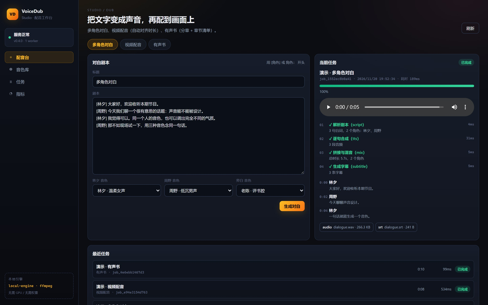

# VoiceDub Studio · AI 配音工作台

> 服务端配音生产：声音设计、参数级音色克隆、多角色对白、视频配音（时长对齐）、有声书。
> 内置离线语音引擎，产出可直接播放的 WAV / SRT / MP4。

[](CHANGELOG.md)
[](https://www.python.org/)
[](https://fastapi.tiangolo.com/)
[](https://ffmpeg.org/)
[](https://github.com/Zzhaocc/voicedub-studio/actions/workflows/ci.yml)
[](LICENSE)

---

## 产品定位

面向**内容团队与工具型产品**的配音生产后端。它把「文字稿 → 成品音视频」拆成可观测的工序：
逐句合成、按真实时长回算时间轴、按目标时长做伸缩、替换音轨，每一步都有产物与耗时记录。

| 维度 | 说明 |
|---|---|
| 目标用户 | 短视频/播客团队、有声书制作、需要批量配音的 SaaS 产品 |
| 核心价值 | 把配音从「一段一段手工处理」变成可批量、可重试、可替换模型的生产队列 |
| 交付形态 | 服务端应用 + Web 控制台 + REST API；Docker / Compose / 裸机 |
| 引擎策略 | 内置离线引擎开箱可用；接真实 TTS 只替换 `synthesize` 实现 |
| 不覆盖 | 语音翻译、口型同步、桌面端打包（见 [能力边界](#能力边界)） |

---

## 能力矩阵

| 模式 | 输入 | 产出 | 关键处理 |
|---|---|---|---|
| 多角色对白 | `[角色] 台词` 脚本 | 对白音频 + 带说话人 SRT | 逐句合成、按角色绑定音色、时间轴由实际音频回算 |
| 视频配音 | 源视频 + 新文案 | 成片 MP4 + 配音轨 + SRT + 原音轨 | `atempo` 级联把配音伸缩到原视频时长，视频轨不重编码 |
| 有声书 | 章节列表 | 全书音频 + 逐句 SRT + 章节清单 JSON | 章内/章间不同静音间隔，章节起止时间按实际音频累加 |
| 声音设计 | 中文描述 | 音色参数（pitch / speed / timbre） | 规则解析，可解释、可测试，可替换为模型 |
| 音色克隆 | 参考音频 | 音色参数 + 分析结果 | 过零率估算基频与音色倾向（参数级，非神经网络克隆） |
| 任务系统 | 任意生产请求 | 步骤级进度、产物清单 | 单 worker 队列、协作式取消、重试、崩溃恢复 |

---

## 快速开始

唯一的外部依赖是 **ffmpeg**（`ffmpeg -version` 能跑即可）。

### Docker（推荐，镜像已含 ffmpeg）

```bash
git clone https://github.com/Zzhaocc/voicedub-studio.git
cd voicedub-studio
docker compose up -d --build
```

打开 <http://127.0.0.1:8000>。数据落在具名卷 `studio-data`，`docker compose down` 不会丢。

### 本地

```bash
git clone https://github.com/Zzhaocc/voicedub-studio.git
cd voicedub-studio
pip install -r requirements.txt
python -m uvicorn app.main:app --port 8000
```

Windows 也可以直接双击 `start.bat`，或运行 `.\scripts\run.ps1 -Port 8000`。

### 命令行验证

```bash
python scripts/demo.py      # 对白 → 视频配音 → 有声书，打印每步耗时与产物
```

---

## 控制台



| 视频配音（对齐时长） | 声音设计 |
|---|---|
|  |  |

更多截图见 [`docs/screenshots/`](docs/screenshots/)：任务列表、指标、有声书。

---

## 三条链路的实现

### 1. 多角色对白

```text
[林夕] 大家好，欢迎收听本期节目。
[周野] 今天聊聊声音设计。
```

解析支持 `[角色]`、`角色：`、无标记（归为旁白）三种写法；
逐句合成后按顺序拼接（句间 0.25s 静音），时间轴由**实际音频时长**回算，
字幕与音频不会漂移。不同角色可以绑定不同音色。

### 2. 视频配音（时长对齐）

原视频 8 秒，新配音只有 6.1 秒时不做截断，而是做时间伸缩：

```text
factor = 合成时长 / 目标时长 = 6.1 / 8.0 = 0.762   # <1 表示放慢
ffmpeg -filter:a "atempo=0.762" -ac 1 -ar 24000 voice_fit.wav
ffmpeg -i demo.mp4 -i voice_fit.wav -map 0:v:0 -map 1:a:0 -c:v copy -c:a aac -shortest dubbed.mp4
```

`atempo` 单次只接受 0.5–2.0，超出就串联多级（代码里做了级联与安全边界）。
字幕按同一缩放系数重算时间轴；视频轨 `-c:v copy` 不重编码，所以单条 8 秒视频约 0.6 秒完成。

### 3. 有声书

章节正文先切句合成，章内用 0.25s 静音，章间用 0.8s 静音；
同时输出 `chapters.json`：每章标题、起止时间、句数，可直接给播放器做章节跳转。

---

## 架构

```text
            ┌────────────── 接入层 ──────────────┐
            │  REST /api · Web 控制台 · Swagger  │
            │  CORS → X-Request-ID → 安全响应头  │
            └────────────────┬───────────────────┘
                             │
        ┌────────────────────▼─────────────────────┐
        │           任务队列 JobRunner              │
        │ 线程池 · 步骤进度 · 取消 · 重试 · 恢复    │
        └───────┬───────────────────────┬──────────┘
                │                       │
      ┌─────────▼─────────┐   ┌─────────▼──────────┐
      │   三条渲染管线     │   │     音色服务        │
      │ 对白/配音/有声书   │   │ 设计解析 · 克隆分析  │
      └─────────┬─────────┘   └─────────┬──────────┘
                │                       │
      ┌─────────▼───────────────────────▼──────────┐
      │                 媒体层                       │
      │ TTS(WAV) · 混音/伸缩 · 响度 · 字幕 · 混流    │
      └─────────────────────────────────────────────┘
```

管线只依赖 `synthesize / concat / mix_dialogue / fit_duration / replace_audio` 几个函数，
换真实 TTS 只需要替换 `app/media/tts.py`。分层细节见 [架构与设计决策](docs/ARCHITECTURE.md)。

---

## 配置

全部通过环境变量注入，完整清单见 [`.env.example`](.env.example) 与 [运维手册](docs/OPERATIONS.md)。

| 变量 | 默认 | 说明 |
|---|---|---|
| `VOICEDUB_DATA_DIR` | `./data` | 数据根目录，派生 `uploads/` `media/` `work/` |
| `DATABASE_URL` | `sqlite:///./data/studio.db` | 换 PostgreSQL 只改这一行 |
| `FFMPEG_BIN` / `FFPROBE_BIN` | `ffmpeg` / `ffprobe` | 可执行文件路径 |
| `VOICEDUB_FFMPEG_TIMEOUT` | `300` | 单条 ffmpeg 命令超时（秒） |
| `VOICEDUB_SAMPLE_RATE` | `24000` | 输出采样率，贯穿 TTS / 混音 / 抽音轨 |
| `VOICEDUB_SEGMENT_GAP` / `VOICEDUB_CHAPTER_GAP` | `0.25` / `0.8` | 句间 / 章间静音 |
| `VOICEDUB_MAX_WORKERS` | `1` | 队列并发 |
| `CORS_ORIGINS` | `*` | 生产填具体域名 |
| `LOG_LEVEL` / `LOG_FORMAT` | `INFO` / `text` | `json` 用于日志采集 |
| `DOCS_ENABLED` | `true` | 生产建议关闭 `/docs` |

---

## API 与集成

完整接口见 [`docs/API.md`](docs/API.md)，可执行示例见 [`examples/api.http`](examples/api.http)。

```bash
# 探针
curl http://127.0.0.1:8000/api/health
curl http://127.0.0.1:8000/api/ready

# 声音设计
curl -X POST http://127.0.0.1:8000/api/voices/design \
  -H "Content-Type: application/json" \
  -d '{"description":"低沉的中年男声，语速偏慢"}'

# 多角色对白
curl -X POST http://127.0.0.1:8000/api/jobs/dialogue \
  -H "Content-Type: application/json" \
  -d '{"script":"[林夕] 你好。\n[周野] 你好啊。","voice_map":{}}'

# 视频配音
curl -X POST http://127.0.0.1:8000/api/jobs/dubbing \
  -H "Content-Type: application/json" \
  -d '{"media_id":"med_xxx","script":"新的配音文案。","voice_id":"voi_xxx"}'

# 查任务 / 下载成片
curl http://127.0.0.1:8000/api/jobs/{job_id}
curl -OJ http://127.0.0.1:8000/api/assets/{asset_id}
```

所有错误响应统一为 `{"detail": ..., "request_id": ...}`，排查时按 `request_id` 检索日志。

### 接入真实 TTS

替换 `app/media/tts.py` 的 `synthesize`，保持返回结构：

```python
{"path": str, "duration": float, "sample_rate": int, "size_bytes": int}
```

上层管线（对白、配音、有声书）与 API 都不用改；实现时采样率取 `settings.sample_rate`，
不要把路径、超时写死。

---

## 部署与运维

```bash
make install-dev     # 安装开发依赖（含测试与 ruff）
make test            # 测试 + 覆盖率（需要 ffmpeg）
make lint            # ruff 静态检查
make smoke           # 对已启动的服务做端到端冒烟
make docker-build    # 构建镜像（内含 ffmpeg）
```

- **探针**：`/api/health`（存活，不查库）、`/api/ready`（就绪：数据库 / ffmpeg / ffprobe / 数据目录可写）；
- **日志**：`LOG_FORMAT=json` 接采集平台，按 `request_id` 关联一次请求；
- **备份**：`sqlite3 data/studio.db ".backup ..."` + 打包 `data/media` 与 `data/uploads`；
- **扩容**：队列是进程内线程池，多机需要换外部队列 + 对象存储；内置接口不带鉴权，对外必须置于网关之后。

部署形态、故障排查表与上线检查清单见 [运维手册](docs/OPERATIONS.md)，
安全边界见 [SECURITY.md](SECURITY.md)，版本策略见 [版本与发布](docs/RELEASE.md)。

---

## 运行指标

本机实测（8 秒占位视频，内置引擎）：

| 通道 | 输入规模 | 耗时 |
|---|---|---|
| 多角色对白 | 3 句 / 5.7s | ~0.2 s |
| 视频配音 | 8s 视频 → 7.97s 成片 | ~0.6 s（倍率 0.762） |
| 有声书 | 2 章 / 9.7s | ~0.2 s |

| 指标 | 数值 |
|---|---|
| 测试 | 35 passed（媒体 7 + 管线 11 + API 7 + 平台 10） |
| 产物规格 | WAV 24kHz 单声道 · SRT · MP4 H.264/AAC |

数字随机器、ffmpeg 版本与文案长度波动，可用 `python scripts/demo.py` 复现。

---

## 版本与支持

- **版本号**：语义化版本，当前 `0.5.0`，变更记录见 [CHANGELOG](CHANGELOG.md)；
- **发布流程**：分支策略、检查清单与回滚见 [版本与发布](docs/RELEASE.md)；
- **质量门禁**：CI 跑 ruff + pytest（3.11 / 3.13，含真实 ffmpeg 编码）+ HTTP 冒烟；
- **支持渠道**：缺陷与需求走 [Issues](https://github.com/Zzhaocc/voicedub-studio/issues)，
  安全问题走 [Security Advisory](SECURITY.md)。

---

## 能力边界

| 项目 | 现状 |
|---|---|
| 语言 | 只做中文 |
| 音色克隆 | 参数级分析（基频 / 过零率），不是神经网络音色嵌入 |
| 视频配音 | 换音轨 + 时长对齐 + 字幕，不做口型同步与翻译 |
| 语音引擎 | 内置确定性谐波合成，音色偏「电子」；接真实 TTS 后音质由模型决定 |
| 形态 | 服务端单副本 + Web 控制台，不做桌面端打包 |

替换真实 TTS 只需实现 `synthesize`，队列、时长对齐、字幕与产物链路完全一致。

---

## Roadmap

| 版本 | 内容 | 状态 |
|---|---|---|
| v0.5 | 生产化加固：结构化日志与 request_id、探针、统一错误契约、容器化、运维与安全文档 | 已交付 |
| v0.6 | 真实 TTS 适配器（CosyVoice / IndexTTS），保留 `synthesize` 契约 | 规划中 |
| v0.7 | 对象存储与产物签名 URL；任务中间文件自动清理 | 规划中 |
| v0.8 | 外部队列 + 多副本；长文案分片与断点续跑 | 规划中 |
| v0.9 | 音色向量（真实克隆）与试听 A/B | 规划中 |

---

## 文档

| 文档 | 内容 |
|---|---|
| [架构与设计决策](docs/ARCHITECTURE.md) | 分层、三条管线、队列、可观测、安全边界、取舍 |
| [API 参考](docs/API.md) | 全部端点、探针、错误契约与示例 |
| [运维手册](docs/OPERATIONS.md) | 部署形态、探针、日志排障、备份、扩容、上线清单 |
| [版本与发布](docs/RELEASE.md) | 版本策略、分支与合并、发布清单、回滚 |
| [安全策略](SECURITY.md) | 安全边界与漏洞报告流程 |
| [贡献指南](CONTRIBUTING.md) | 本地开发、PR 前检查、如何接真实 TTS |

---

## 许可

MIT License，见 [LICENSE](LICENSE)。示例素材与音色均为程序生成，不含真实人物音频；
产品形态来源见文末致谢。

<details>
<summary>产品形态来源</summary>

服务端形态与三类生产模式的产品定义参考开源桌面工具
[VoiceStudio](https://github.com/debpalash/VoiceStudio)。
</details>
