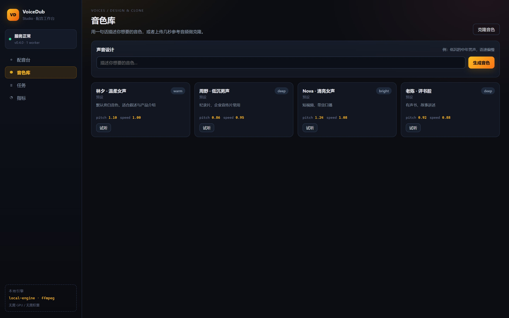

# VoiceDub Studio · AI 配音工作台

> 服务端配音工作台：声音设计、音色克隆、多角色对白、视频配音、有声书。
> 内置离线语音引擎，不需要 GPU、模型权重或 API key。

[](https://www.python.org/)
[](https://fastapi.tiangolo.com/)
[](https://ffmpeg.org/)
[](https://github.com/Zzhaocc/voicedub-studio/actions/workflows/ci.yml)
[]()
[](LICENSE)

**仓库**：<https://github.com/Zzhaocc/voicedub-studio>

---

## 这是什么

VoiceDub Studio 是服务端的 AI 配音工作台：给一段文案，得到带语音和字幕的成品。

| 模式 | 输入 | 产物 |
|---|---|---|
| 多角色对白 | `[角色] 台词` 脚本 | 对白音频 + 带说话人的 SRT |
| 视频配音 | 源视频 + 新文案 | 时长对齐的成片 MP4 + 配音轨 + SRT + 原音轨 |
| 有声书 | 章节列表 | 全书音频 + 逐句 SRT + 章节清单 JSON |

内置离线语音引擎：numpy 按基频 + 谐波 + 包络合成语音，不需要 GPU、模型权重或 API key；
产出是真实可播放的 24kHz WAV、标准 SRT、H.264/AAC MP4。

生产走服务端队列：步骤级进度、协作式取消、失败重试、崩溃恢复，可以批量跑。

---

## 30 秒跑起来

唯一的外部依赖是 **ffmpeg**（`ffmpeg -version` 能跑即可）。

### Docker（推荐，镜像已含 ffmpeg）

```bash
git clone https://github.com/Zzhaocc/voicedub-studio.git
cd voicedub-studio
docker compose up -d --build
```

打开 <http://127.0.0.1:8000>。数据落在具名卷 `studio-data`，`docker compose down` 不会丢。

### 本地

```bash
git clone https://github.com/Zzhaocc/voicedub-studio.git
cd voicedub-studio
pip install -r requirements.txt
python -m uvicorn app.main:app --port 8000
```

Windows 也可以直接双击 `start.bat`，或运行 `.\scripts\run.ps1 -Port 8000`。

### 不启服务也能验证

```bash
python scripts/demo.py      # 对白 → 视频配音 → 有声书，打印每步耗时与产物
```

三种模式都有预填示例，打开控制台点按钮即可生成。

---

## 控制台


| 视频配音（对齐时长） | 声音设计 |
|---|---|
|  |  |

更多截图见 [`docs/screenshots/`](docs/screenshots/)：任务列表、指标、有声书。

---

## 三条链路的实现细节

### 1. 多角色对白

```text
[林夕] 大家好，欢迎收听本期节目。
[周野] 今天聊聊声音设计。
```

解析支持 `[角色]`、`角色：`、无标记（归为旁白）三种写法；
逐句合成后按顺序拼接（句间 0.25s 静音），时间轴由**实际音频时长**回算，
所以字幕与音频不会漂移。不同角色可以绑定不同音色。

### 2. 视频配音（时长对齐）

原视频 8 秒，新配音只有 6.1 秒，怎么办？不是截断，而是做时间伸缩：

```text
factor = 合成时长 / 目标时长 = 6.1 / 8.0 = 0.762   # <1 表示放慢
ffmpeg -filter:a "atempo=0.762" -ac 1 -ar 24000 voice_fit.wav
ffmpeg -i demo.mp4 -i voice_fit.wav -map 0:v:0 -map 1:a:0 -c:v copy -c:a aac -shortest dubbed.mp4
```

`atempo` 单次只接受 0.5–2.0，超出就串联多级（代码里做了级联与安全边界）。
字幕按同一缩放系数重算时间轴。视频轨 `-c:v copy` 不重编码，所以很快。

### 3. 有声书

章节正文先切句合成，章内用 0.25s 静音，章间用 0.8s 静音；
同时输出 `chapters.json`：每章标题、起止时间、句数，可以直接给播放器做章节跳转。

---

## 架构

```text
            ┌────────────── 接入层 ──────────────┐
            │  REST /api · Web 控制台 · Swagger  │
            │  CORS → X-Request-ID → 安全响应头  │
            └────────────────┬───────────────────┘
                             │
        ┌────────────────────▼─────────────────────┐
        │           任务队列 JobRunner              │
        │ 线程池 · 步骤进度 · 取消 · 重试 · 恢复    │
        └───────┬───────────────────────┬──────────┘
                │                       │
      ┌─────────▼─────────┐   ┌─────────▼──────────┐
      │   三条渲染管线     │   │     音色服务        │
      │ 对白/配音/有声书   │   │ 设计解析 · 克隆分析  │
      └─────────┬─────────┘   └─────────┬──────────┘
                │                       │
      ┌─────────▼───────────────────────▼──────────┐
      │                 媒体层                       │
      │ TTS(WAV) · 混音/伸缩 · 响度 · 字幕 · 混流    │
      └─────────────────────────────────────────────┘
```

**边界**：管线只依赖 `synthesize / concat / mix_dialogue / fit_duration / replace_audio` 这几个函数，
换真实 TTS（CosyVoice、IndexTTS）只需要替换 `app/media/tts.py`，其余不动。

分层细节、任务队列、失败模式与取舍见 [架构与设计决策](docs/ARCHITECTURE.md)。

---

## 配置

全部通过环境变量注入，完整清单见 [`.env.example`](.env.example) 与 [运维手册](docs/OPERATIONS.md)。

| 变量 | 默认 | 说明 |
|---|---|---|
| `VOICEDUB_DATA_DIR` | `./data` | 数据根目录，派生 `uploads/` `media/` `work/` |
| `DATABASE_URL` | `sqlite:///./data/studio.db` | 换 PostgreSQL 只改这一行 |
| `FFMPEG_BIN` / `FFPROBE_BIN` | `ffmpeg` / `ffprobe` | 可执行文件路径 |
| `VOICEDUB_FFMPEG_TIMEOUT` | `300` | 单条 ffmpeg 命令超时（秒） |
| `VOICEDUB_SAMPLE_RATE` | `24000` | 输出采样率，贯穿 TTS / 混音 / 抽音轨 |
| `VOICEDUB_SEGMENT_GAP` / `VOICEDUB_CHAPTER_GAP` | `0.25` / `0.8` | 句间 / 章间静音 |
| `VOICEDUB_MAX_WORKERS` | `1` | 队列并发 |
| `CORS_ORIGINS` | `*` | 生产填具体域名 |
| `LOG_LEVEL` / `LOG_FORMAT` | `INFO` / `text` | `json` 用于日志采集 |
| `DOCS_ENABLED` | `true` | 生产建议关闭 `/docs` |

---

## API 示例

```bash
# 探针
curl http://127.0.0.1:8000/api/health
curl http://127.0.0.1:8000/api/ready

# 声音设计
curl -X POST http://127.0.0.1:8000/api/voices/design \
  -H "Content-Type: application/json" \
  -d '{"description":"低沉的中年男声，语速偏慢"}'

# 多角色对白
curl -X POST http://127.0.0.1:8000/api/jobs/dialogue \
  -H "Content-Type: application/json" \
  -d '{"script":"[林夕] 你好。\n[周野] 你好啊。","voice_map":{}}'

# 视频配音
curl -X POST http://127.0.0.1:8000/api/jobs/dubbing \
  -H "Content-Type: application/json" \
  -d '{"media_id":"med_xxx","script":"新的配音文案。","voice_id":"voi_xxx"}'

# 查任务 / 下载成片
curl http://127.0.0.1:8000/api/jobs/{job_id}
curl -OJ http://127.0.0.1:8000/api/assets/{asset_id}
```

完整接口见 [`docs/API.md`](docs/API.md)，可执行示例见 [`examples/api.http`](examples/api.http)。
所有错误响应统一为 `{"detail": ..., "request_id": ...}`，排查时按 `request_id` 检索日志。

---

## 部署与运维

```bash
make install-dev     # 安装开发依赖（含测试与 ruff）
make test            # 测试 + 覆盖率（需要 ffmpeg）
make lint            # ruff 静态检查
make smoke           # 对已启动的服务做端到端冒烟
make docker-build    # 构建镜像（内含 ffmpeg）
```

- **探针**：`/api/health`（存活，不查库）、`/api/ready`（就绪：数据库 / ffmpeg / ffprobe / 数据目录可写）；
- **日志**：`LOG_FORMAT=json` 接采集平台，按 `request_id` 关联一次请求；
- **备份**：`sqlite3 data/studio.db ".backup ..."` + 打包 `data/media` 与 `data/uploads`；
- **扩容**：队列是进程内线程池，多机需要换外部队列 + 对象存储；内置接口不带鉴权，对外必须置于网关之后。

完整部署形态、故障排查表与上线检查清单见 [运维手册](docs/OPERATIONS.md)，
安全边界与漏洞报告流程见 [SECURITY.md](SECURITY.md)。

---

## 测试

```bash
python -m pytest -q     # 35 passed
```

| 分组 | 数量 | 覆盖 |
|---|---|---|
| 媒体层 | 7 | WAV 头与时长、静音拼接、对白时间轴、**时长伸缩（2× / 0.5×）**、响度归一、视频混流、封面 |
| 管线 | 11 | 剧本解析三种写法、章节校验、声音设计关键词映射、三条链路端到端、取消与重试 |
| API | 7 | 契约校验（422/404/409）、音色试听、产物下载、指标 |
| 平台 | 10 | 探针、request_id、安全响应头、错误契约、时间戳、配置解析、ffmpeg 路径与数据目录 |

CI 在 push / PR 时跑 ruff + pytest（3.11 / 3.13，含真实 ffmpeg 编码）+ HTTP 冒烟，
见 [`.github/workflows/ci.yml`](.github/workflows/ci.yml)。

---

## 能力边界

| 项目 | 现状 |
|---|---|
| 语言 | 只做中文 |
| 音色克隆 | 参数级分析（基频 / 过零率），不是神经网络音色嵌入 |
| 视频配音 | 换音轨 + 时长对齐 + 字幕，不做口型同步与翻译 |
| 语音引擎 | 内置确定性谐波合成，音色偏"电子"；接真实 TTS 后音质由模型决定 |
| 形态 | 服务端单副本 + Web 控制台，不做桌面端打包 |

替换真实 TTS 只需实现 `synthesize`，队列、时长对齐、字幕与产物链路完全一致。

---

## 目录

```text
voicedub-studio/
├── app/
│   ├── main.py                  # 应用装配、中间件、启动自检、崩溃恢复
│   ├── config.py                # 环境变量配置（单一数据根目录）
│   ├── logging.py               # 结构化日志 + request_id 注入
│   ├── middleware.py            # 请求关联 ID、访问日志、安全响应头
│   ├── errors.py                # 统一错误响应
│   ├── db.py / models.py        # SQLAlchemy 模型（Voice/Media/Job/JobStep/Asset）
│   ├── api/                     # REST 路由 + 请求模型
│   ├── voices/                  # 声音设计解析、克隆分析
│   ├── pipeline/                # 剧本解析、三条渲染管线、任务队列
│   └── media/                   # TTS(WAV) · 混音/伸缩 · 字幕 · 视频混流
├── web/                         # 单页控制台
├── tests/                       # 媒体 / 管线 / API / 平台（35 个）
├── scripts/                     # demo / 冒烟 / 截图
├── examples/                    # curl / .http
├── docs/                        # 架构、API、运维手册、截图
├── Dockerfile                   # 多阶段构建，内置 ffmpeg、非 root
├── docker-compose.yml
└── Makefile                     # install / run / test / lint / smoke / docker-*
```

---

## Roadmap

| 版本 | 内容 |
|---|---|
| v0.5（当前） | 生产化加固：结构化日志与 request_id、探针、统一错误契约、容器化、运维与安全文档 |
| v0.6 | 真实 TTS 适配器（CosyVoice / IndexTTS），保留 `synthesize` 契约 |
| v0.7 | 对象存储与产物签名 URL；任务中间文件自动清理 |
| v0.8 | 外部队列 + 多副本；长文案分片与断点续跑 |
| v0.9 | 音色向量（真实克隆）与试听 A/B 对比 |

变更记录见 [CHANGELOG.md](CHANGELOG.md)。

---

## 文档

- [架构与设计决策](docs/ARCHITECTURE.md) —— 分层、三条管线、队列、可观测、安全边界、取舍
- [API 参考](docs/API.md) —— 全部端点、探针、错误契约与示例
- [运维手册](docs/OPERATIONS.md) —— 部署形态、探针、日志排障、备份、扩容、上线清单
- [安全策略](SECURITY.md) —— 安全边界与漏洞报告流程
- [贡献指南](CONTRIBUTING.md) —— 本地开发、PR 前必过的检查、如何接真实 TTS

---

## 致谢与许可

- 致谢 [VoiceStudio](https://github.com/debpalash/VoiceStudio)：产品形态来源；
- 示例素材是程序生成的占位视频，不含真实人物音频；
- MIT License，见 [LICENSE](LICENSE)。
