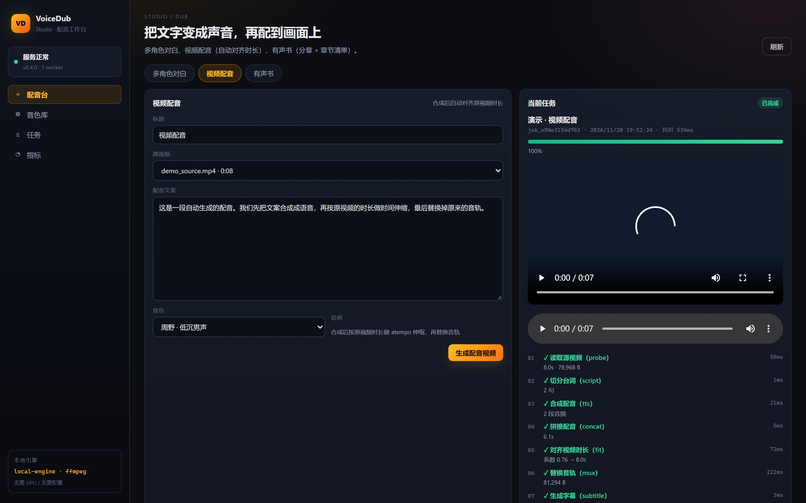

# VoiceDub Studio · AI 配音工作台

> 一句话描述出一个音色，写完稿子就得到成品：多角色对白、视频配音、有声书。
> 服务端可运行，内置离线语音引擎，**不需要 GPU、模型权重或 API key**。

[]()
[]()
[]()
[](https://github.com/Zzhaocc/voicedub-studio/actions/workflows/ci.yml)
[]()
[]()

**仓库**：<https://github.com/Zzhaocc/voicedub-studio>

---

## 这是什么

参考项目 [VoiceStudio](https://github.com/debpalash/VoiceStudio) 是一个「本地版 ElevenLabs」桌面应用：
声音克隆、声音设计、视频配音、转录、有声书。

本项目取其中**最能体现工程能力的一条线**，做成服务端平台：

| 能力 | 这里的实现 |
|---|---|
| 声音设计 | 中文描述 → 规则解析成 pitch / speed / timbre，可解释、可测试、可替换成模型 |
| 音色克隆 | 上传参考音频 → 过零率估算基频与音色 → 直接用于合成 |
| 多角色对白 | `[角色] 台词` 解析 → 逐句合成 → 按角色拼接 → 带说话人的 SRT |
| 视频配音 | 合成 → **atempo 对齐原视频时长** → 替换音轨 → 输出可播放 MP4 |
| 有声书 | 章节 → 逐章合成 → 全书音频 + 字幕 + `chapters.json`（章节起止时间） |
| 任务系统 | 单 worker 队列、步骤级进度、协作式取消、重试、崩溃恢复 |

**产出是真的**：24kHz WAV、标准 SRT、H.264/AAC MP4，播放器直接能放。

---

## 30 秒跑起来

```bash
cd VoiceDub-Studio
pip install -r requirements.txt
python -m uvicorn app.main:app --port 8000
```

打开 <http://127.0.0.1:8000>，三种模式都有预填示例，点按钮即可生成。

```bash
# 或者命令行跑完三条链路
python scripts/demo.py
```

依赖只有一个：`ffmpeg` 在 PATH 里。

---

## 控制台


| 视频配音（对齐时长） | 声音设计 |
|---|---|
|  |  |

---

## 三条链路的实现细节

### 1. 多角色对白

```text
[林夕] 大家好，欢迎收听本期节目。
[周野] 今天聊聊声音设计。
```

解析支持 `[角色]`、`角色：`、无标记（归为旁白）三种写法；
逐句合成后按顺序拼接（句间 0.25s 静音），时间轴由**实际音频时长**回算，
所以字幕与音频不会漂移。不同角色可以绑定不同音色。

### 2. 视频配音（本项目最有意思的一段）

原视频 8 秒，新配音只有 6.1 秒，怎么办？不是截断，而是做时间伸缩：

```text
factor = 合成时长 / 目标时长 = 6.1 / 8.0 = 0.762   # <1 表示放慢
ffmpeg -filter:a "atempo=0.762" -ac 1 -ar 24000 voice_fit.wav
ffmpeg -i demo.mp4 -i voice_fit.wav -map 0:v:0 -map 1:a:0 -c:v copy -c:a aac -shortest dubbed.mp4
```

`atempo` 单次只接受 0.5–2.0，超出就串联多级（代码里做了级联与安全边界）。
字幕按同一缩放系数重算时间轴。视频轨 `-c:v copy` 不重编码，所以很快。

### 3. 有声书

章节正文先切句合成，章内用 0.25s 静音，章间用 0.8s 静音；
同时输出 `chapters.json`：每章标题、起止时间、句数，可以直接给播放器做章节跳转。

---

## 架构

```text
            ┌────────────── 接入层 ──────────────┐
            │  REST /api · Web 控制台 · Swagger  │
            └────────────────┬───────────────────┘
                             │
        ┌────────────────────▼─────────────────────┐
        │           任务队列 JobRunner              │
        │ 单 worker · 步骤进度 · 取消 · 重试 · 恢复 │
        └───────┬───────────────────────┬──────────┘
                │                       │
      ┌─────────▼─────────┐   ┌─────────▼──────────┐
      │   三条渲染管线     │   │     音色服务        │
      │ 对白/配音/有声书   │   │ 设计解析 · 克隆分析  │
      └─────────┬─────────┘   └─────────┬──────────┘
                │                       │
      ┌─────────▼───────────────────────▼──────────┐
      │                 媒体层                       │
      │ TTS(WAV) · 混音/伸缩/响度 · 字幕(SRT) · 混流  │
      └─────────────────────────────────────────────┘
```

**边界**：管线只依赖 `synthesize / concat / mix_dialogue / fit_duration / replace_audio` 这几个函数，
换真实 TTS（CosyVoice、IndexTTS）只需要替换 `app/media/tts.py`，其余不动。

---

## 测试

```bash
python -m pytest -q     # 25 passed
```

- 媒体层 7 个：WAV 头与时长、静音拼接、对白时间轴、**时长伸缩（2× / 0.5×）**、响度归一、视频混流、封面
- 管线 11 个：剧本解析三种写法、章节校验、声音设计关键词映射、三条链路端到端、取消与重试
- API 7 个：契约校验（422/404/409）、音色试听、产物下载、指标

---

## 与参考项目的差异（如实说）

| VoiceStudio | 本项目 |
|---|---|
| Electron 桌面端 + 真实模型（OmniVoice 等） | 服务端 FastAPI + 内置离线引擎 |
| 声音克隆用神经网络音色嵌入 | 用参考音频的基频/过零率估算音色参数（可解释，但不是真克隆） |
| 视频配音含翻译、口型 | 只做「换音轨 + 时长对齐 + 字幕」，不做口型 |
| 646 种语言、模型管理器 | 只做中文，聚焦管线与工程 |

**没有做的事**：不下载模型权重、不做语音翻译、不做口型同步、不做桌面打包。
这些是产品功能；本项目证明的是「配音生产可以工程化」。

---

## API 示例

```bash
# 声音设计
curl -X POST http://127.0.0.1:8000/api/voices/design \
  -H "Content-Type: application/json" \
  -d '{"description":"低沉的中年男声，语速偏慢"}'

# 多角色对白
curl -X POST http://127.0.0.1:8000/api/jobs/dialogue \
  -H "Content-Type: application/json" \
  -d '{"script":"[林夕] 你好。\n[周野] 你好啊。","voice_map":{}}'

# 视频配音
curl -X POST http://127.0.0.1:8000/api/jobs/dubbing \
  -H "Content-Type: application/json" \
  -d '{"media_id":"med_xxx","script":"新的配音文案。","voice_id":"voi_xxx"}'

# 查任务 / 下载成片
curl http://127.0.0.1:8000/api/jobs/{job_id}
curl -OJ http://127.0.0.1:8000/api/assets/{asset_id}
```

完整接口见 [`docs/API.md`](docs/API.md)，可执行示例见 [`examples/api.http`](examples/api.http)。

---

## 目录

```text
VoiceDub-Studio/
├── app/
│   ├── main.py / config.py / db.py / models.py
│   ├── api/              # REST 路由 + 请求模型
│   ├── voices/           # 声音设计解析、克隆分析
│   ├── pipeline/         # 剧本解析、三条渲染管线、任务队列
│   └── media/            # TTS(WAV) · 混音/伸缩 · 字幕 · 视频混流
├── web/                  # 单页控制台
├── tests/                # 媒体 + 管线 + API
├── scripts/              # demo / 冒烟 / 截图
├── examples/             # curl / .http
└── docs/                 # 架构、API、截图
```

## License

MIT
